<p align="center">
  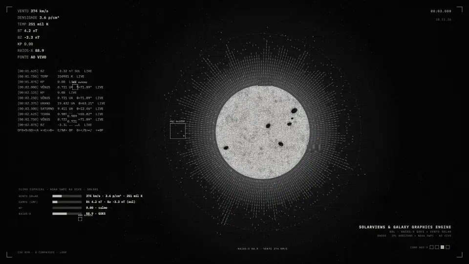
</p>

<h1 align="center">SOLARVIEWS &amp; GALAXY GRAPHICS ENGINE</h1>

<p align="center">
  Visuais generativos do sistema solar, movidos por dados espaciais ao vivo.<br>
  Para projeção ao vivo (VJ) e para vídeo.<br><br>
  Criado por <a href="https://marciusm.com"><b>Marcius Monteiro</b></a>
</p>

<p align="center">
  <a href="#dados-ao-vivo">Dados ao vivo</a> ·
  <a href="#vídeos">Vídeos</a> ·
  <a href="#composições">Composições</a> ·
  <a href="#como-usar">Como usar</a> ·
  <a href="#como-funciona">Como funciona</a> ·
  <a href="#como-foi-desenvolvida">Como foi desenvolvida</a> ·
  <a href="docs/MANUAL.md">Manual completo</a> ·
  <a href="#in-english">English</a>
</p>

---

Sol, planetas, luas, céu e galáxia são camadas que se combinam em composições. Cada camada se move com dados reais do espaço: vento solar, campo magnético, tempestades geomagnéticas, explosões solares e posições dos planetas. Elas também andam no tempo da música e reagem ao som.

Tudo roda no navegador, num único arquivo HTML, sem instalar nada.

- **17 composições** de exemplo e **21 tipos de camada**, todos com parâmetros ajustáveis.
- **Dados ao vivo** do NOAA SWPC e do NASA/JPL Horizons, com a origem de cada valor na tela.
- **Música:** solte um áudio e as camadas reagem a graves, médios, agudos e ataques. As cenas trocam as composições no tempo da faixa, e um diretor automático monta as cenas sozinho.
- **Ao vivo:** janela de saída para o projetor, troca de composição pelas teclas 1 a 9 ou por controlador MIDI, blackout e alertas de clima espacial.
- **Exportação:** MP4 pronto para Reels, feed e YouTube (vertical, quadrado, Full HD, 4K), PNG, sequência PNG e WebM.
- **Português e inglês:** botão PT/EN no topo e na tela de abertura (ou `?lang=en` na URL). A tradução vale também para os textos desenhados na prancheta, então os vídeos saem no idioma escolhido.

## Dados ao vivo

Os números nas telemetrias e o movimento das camadas vêm de fontes públicas, lidas enquanto a ferramenta está aberta:

| Dado | Fonte | Atualização |
|---|---|---|
| Vento solar: velocidade, densidade e temperatura | [NOAA SWPC](https://www.swpc.noaa.gov/), Real-Time Solar Wind, medido por satélites entre a Terra e o Sol | velocidade a cada 30 s; densidade e temperatura a cada 5 min |
| Campo magnético interplanetário (Bt, Bz, By) | NOAA SWPC | a cada 30 s |
| Índice Kp, a atividade geomagnética de 0 a 9 | NOAA SWPC, Kp planetário estimado | a cada 30 s |
| Raios-X do Sol (classes A, B, C, M e X) | NOAA SWPC, satélites GOES | a cada 30 s |
| Posições dos planetas | [NASA/JPL Horizons](https://ssd.jpl.nasa.gov/horizons/), pelo servidor local | a cada 10 min |
| Posições dos planetas, sem o servidor | elementos orbitais do JPL (E. M. Standish), calculados no navegador | a cada quadro |
| Céu: estrelas, Lua, planetas e hora sideral | cálculo astronômico com o relógio real, visto de São Paulo (ajustável) | a cada quadro |

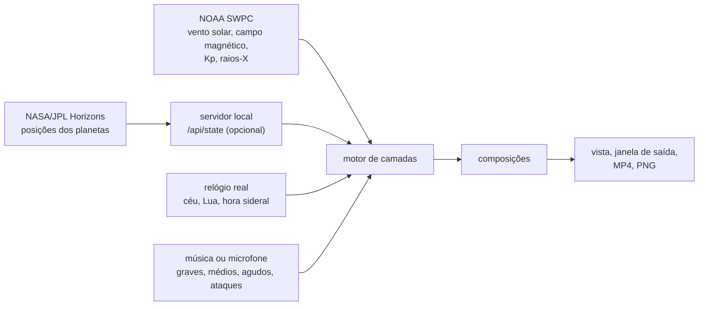

O navegador lê os dados do NOAA direto da fonte, porque `services.swpc.noaa.gov` permite esse acesso. Por isso a ferramenta continua ao vivo mesmo publicada como site estático.

Cada camada mostra de onde vem o valor:

- **AO VIVO:** dado real.
- **DEMO:** simulação, com uma tempestade a cada 5 minutos, para testar os alertas.
- **TÍPICO:** sem conexão, com valores médios.

Quando um dado real passa do limite, a prancheta dispara um alerta. Os limites são Kp alto, explosão solar classe M ou X, campo Bz muito ao sul ou vento rápido.

## Vídeos

<table>
  <tr>
    <td width="50%" valign="top">
      <a href="docs/video/showreel.mp4">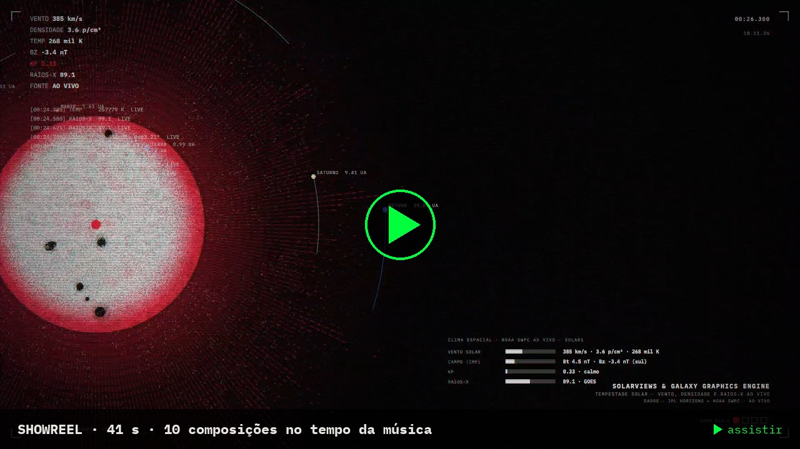</a>
      <p><b>Showreel</b> · 41 s · 1080p<br>Dez composições trocando no tempo da música, com transições e movimento de câmera em cada cena. A própria ferramenta exportou o vídeo, quadro a quadro, com os dados ao vivo do momento.</p>
    </td>
    <td width="50%" valign="top">
      <a href="docs/video/tutorial.mp4">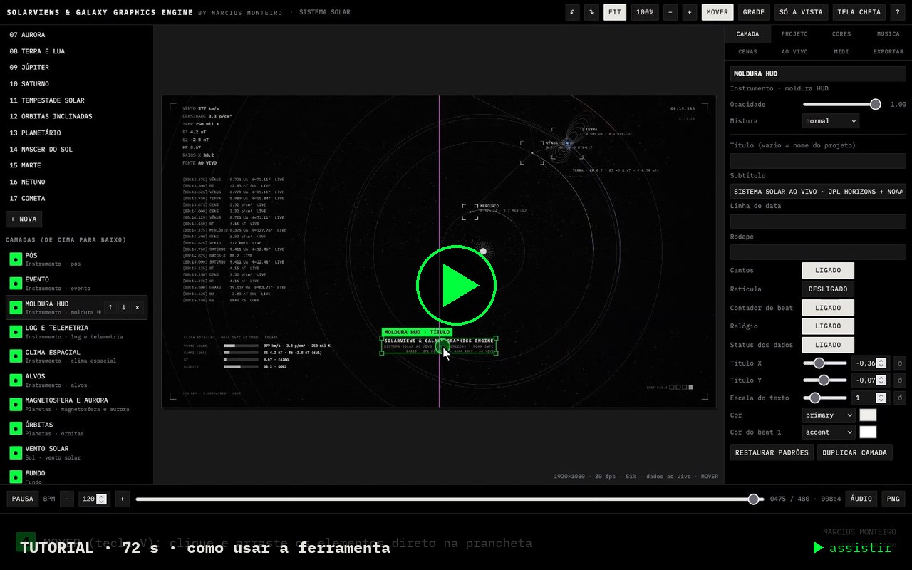</a>
      <p><b>Tutorial</b> · 72 s<br>Como usar a ferramenta, gravado da interface real em oito passos: composições, camadas, câmera, MOVER, códigos ao vivo, música e cenas, ao vivo e exportar.</p>
    </td>
  </tr>
</table>

A trilha do showreel foi gerada para este projeto e não usa música de terceiros. Ela está em [`docs/audio/`](docs/audio/) e pode ser usada para testar a parte de música da ferramenta.

## Composições

<p align="center">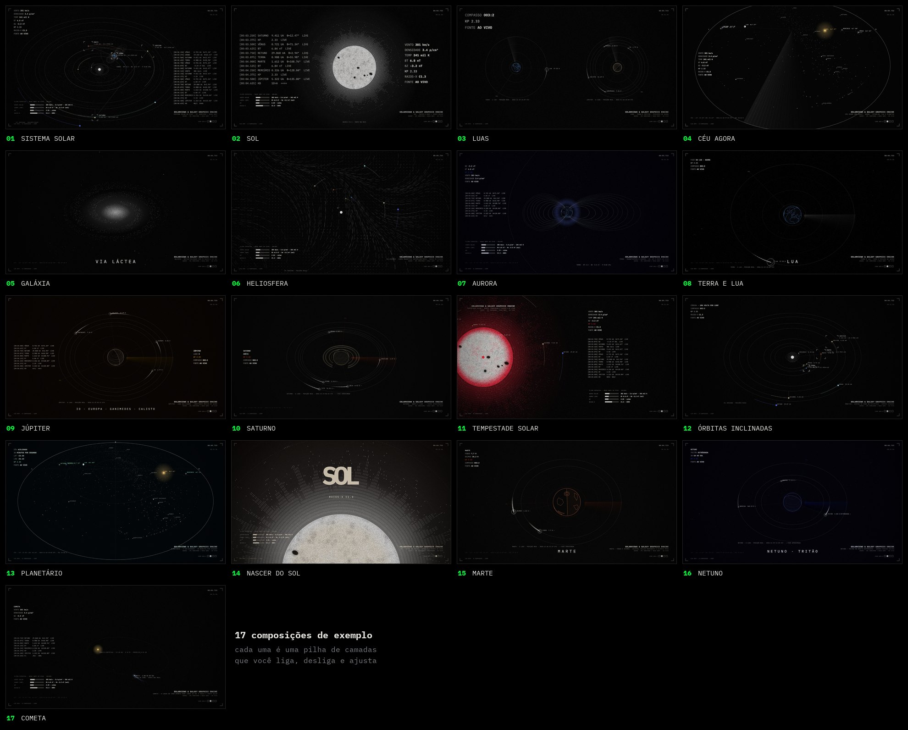</p>

<table>
  <tr>
    <td width="50%">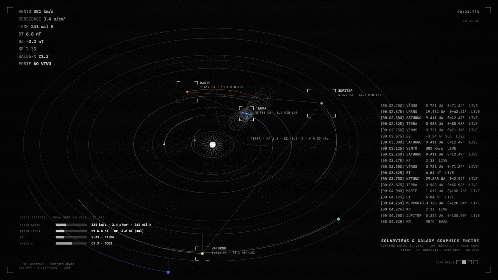<br><b>Sistema Solar</b>: os planetas nas posições reais do JPL, magnetosfera da Terra, clima espacial e log de telemetria.</td>
    <td width="50%">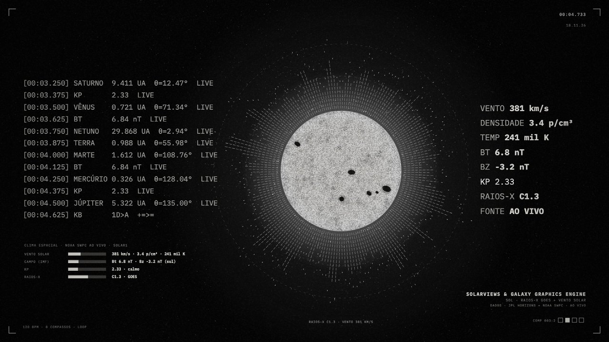<br><b>Sol</b>: a coroa é um analisador de espectro circular. Os raios-X do GOES sobem o teto das barras.</td>
  </tr>
  <tr>
    <td>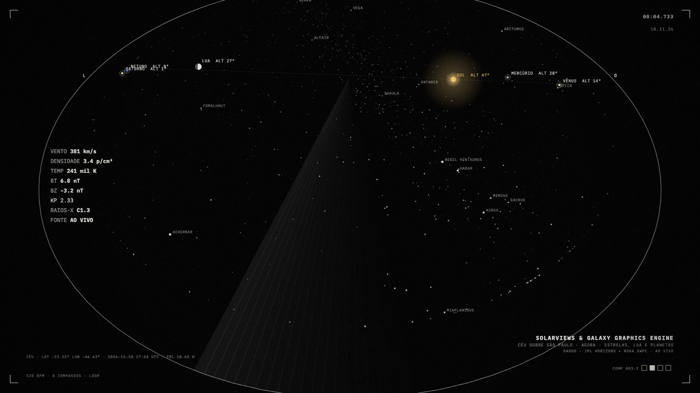<br><b>Céu agora</b>: estrelas, Lua e planetas onde estão neste instante, vistos de São Paulo, em perspectiva.</td>
    <td>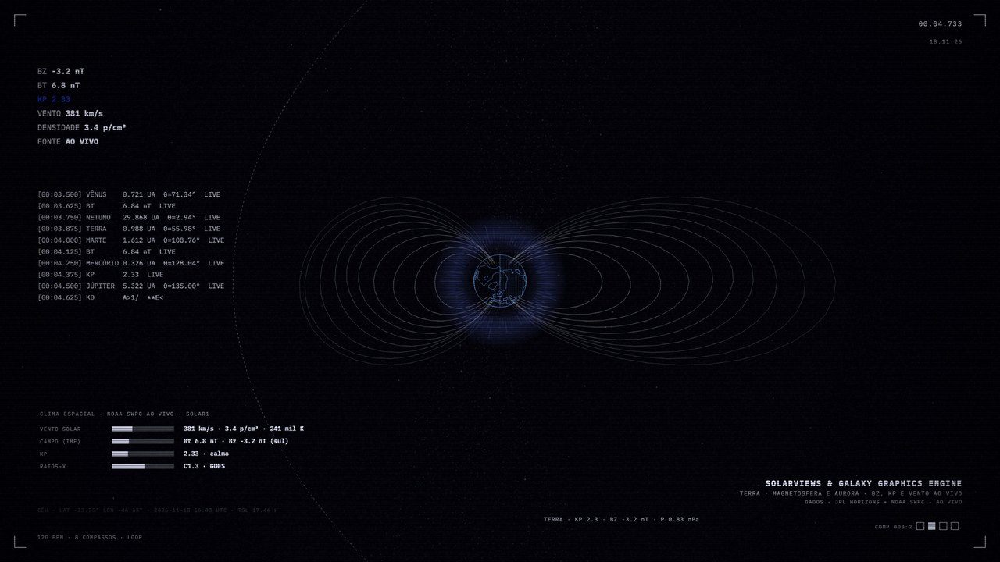<br><b>Aurora</b>: as linhas de campo da Terra se comprimem com a pressão do vento solar, e a aurora cresce com o Kp.</td>
  </tr>
  <tr>
    <td>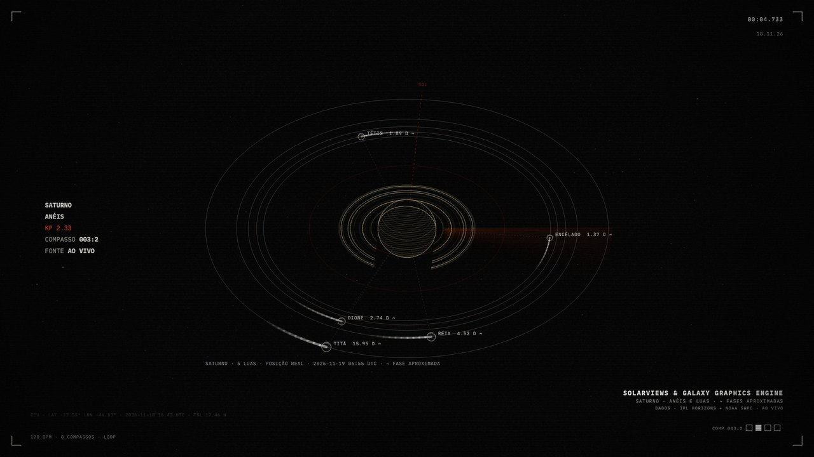<br><b>Saturno</b>: o planeta com os anéis, a sombra deles e as luas nos períodos reais.</td>
    <td>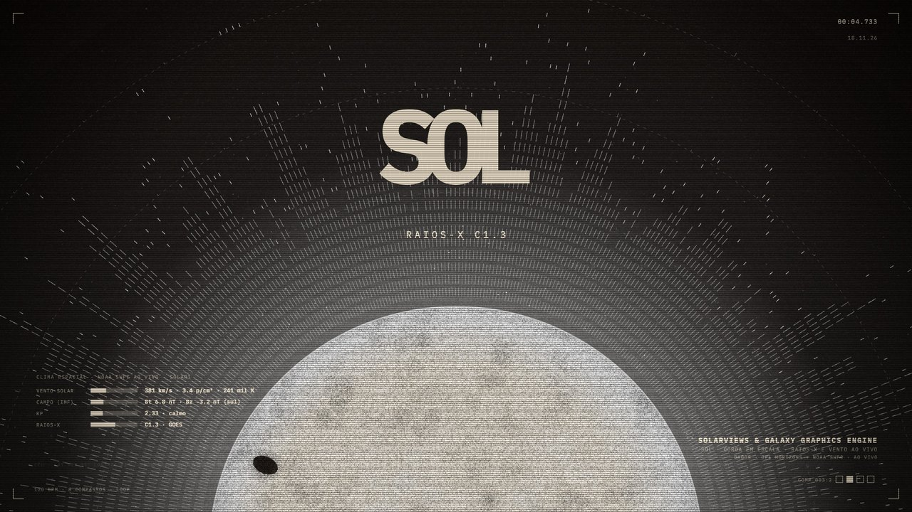<br><b>Nascer do Sol</b>: o disco nascendo no horizonte, com as barras reagindo ao som.</td>
  </tr>
  <tr>
    <td>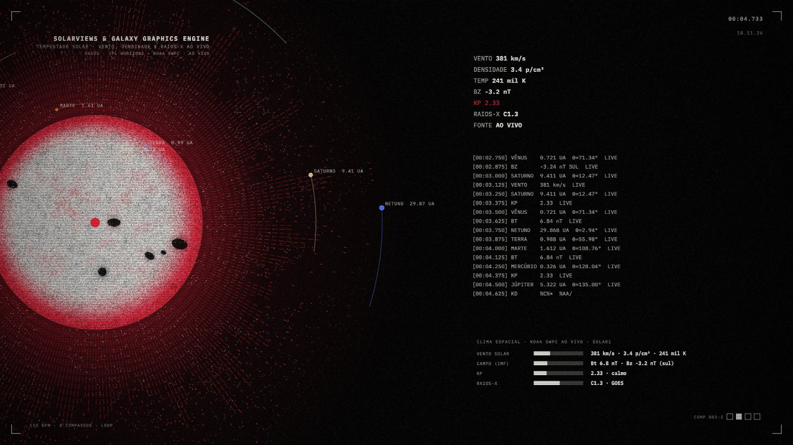<br><b>Tempestade Solar</b>: vento, densidade e raios-X ao vivo em vermelho de alarme.</td>
    <td>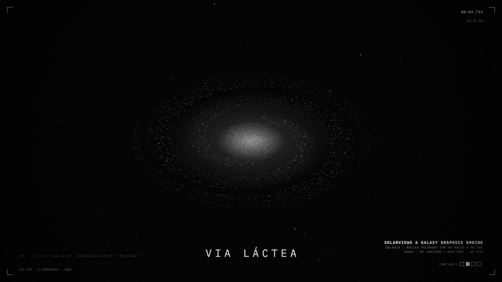<br><b>Galáxia</b>: uma espiral cujo núcleo pulsa com os raios-X do Sol.</td>
  </tr>
</table>

## Como usar

### No navegador

1. Baixe este repositório (botão **Code → Download ZIP**) ou clone com `git clone`.
2. Abra o `index.html` no Chrome, no Edge ou no Firefox. Não precisa instalar nada, nem rodar servidor ou criar conta.
3. A tela de abertura explica a ferramenta e as fontes dos dados. Escolha uma composição à esquerda e explore.
4. Para trocar o idioma, use PT ou EN no topo. A escolha fica salva no navegador; na primeira abertura, vale o idioma do navegador.

<p align="center">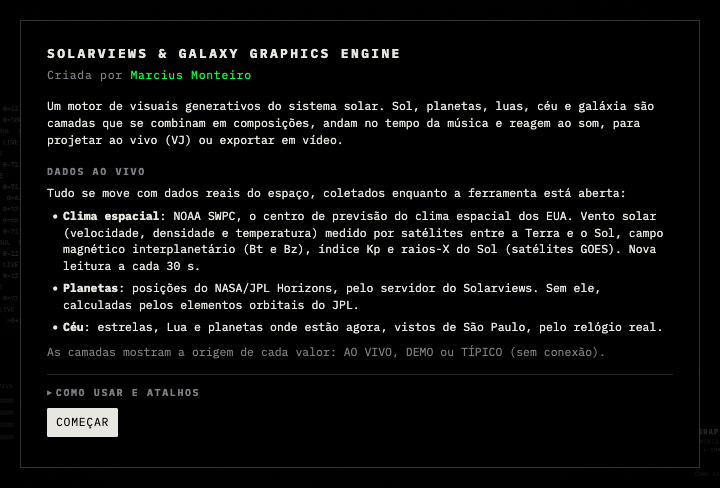</p>

### Num site

Suba o `index.html` e a pasta `font/` para qualquer hospedagem estática, como o GitHub Pages ou o seu próprio site. O clima espacial continua ao vivo pelo NOAA, e as posições dos planetas usam os elementos orbitais do JPL.

### Com o servidor local (opcional)

O servidor (`server.js`, incluído neste repositório) é um programa Node, sem dependências, que consulta o JPL Horizons e o NOAA e entrega tudo em `/api/state`. Com ele rodando, as posições dos planetas vêm do Horizons e a ferramenta abre em `http://localhost:3000/`. Por esse endereço, o Firefox libera controladores MIDI.

### Atalhos principais

| Tecla | Ação |
|---|---|
| Espaço | toca e pausa a animação |
| Arrastar na prancheta | gira e inclina a câmera; a roda do mouse aproxima |
| V | modo MOVER: arraste os elementos direto na prancheta |
| 1 a 9 | troca a composição, com transição |
| M | toca e pausa a música |
| N | marca uma cena no ponto da música |
| B | blackout da vista e da janela de saída |
| G | grade e área segura |
| H · F | só a vista · tela cheia |
| S | salva PNG |
| ⌘Z · ⇧⌘Z | desfaz e refaz |
| ? | ajuda e lista completa de atalhos |

### Navegadores

| Recurso | Chrome e Edge | Firefox |
|---|---|---|
| Ferramenta, dados ao vivo, PNG, sequência PNG, WebM | sim | sim |
| Exportar MP4 (WebCodecs) | H.264 + AAC | H.264 + Opus, ou MOV com PCM |
| Controlador MIDI | sim | só por `http://localhost` |

A ferramenta foi testada no Firefox e no Chrome. No Safari ela ainda não foi testada, e o Safari não tem Web MIDI.

O projeto fica salvo no próprio navegador e pode ser levado para outra máquina como JSON (aba PROJETO). Nada sai do computador: a ferramenta só faz rede para ler os dados públicos do NOAA e do JPL.

## Como funciona

<p align="center">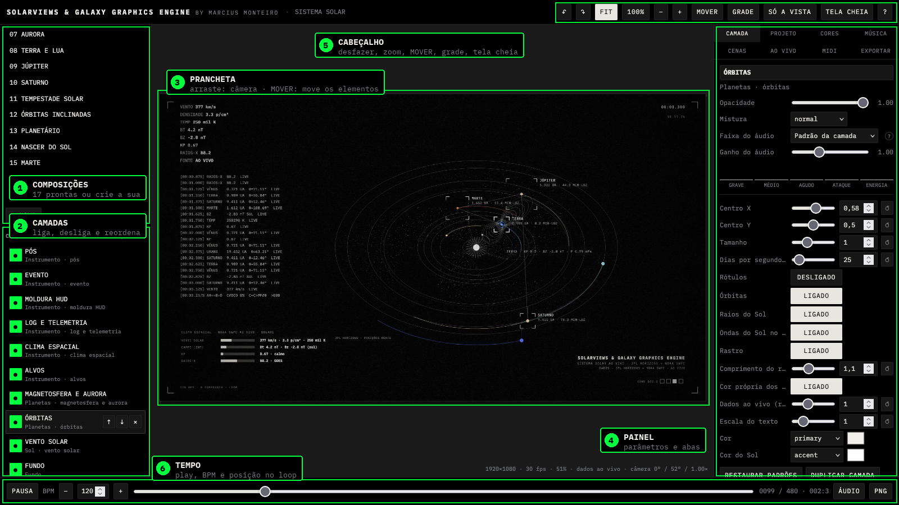</p>

1. **Composições:** as 17 prontas, ou crie a sua.
2. **Camadas:** a pilha da composição. Ligue, desligue, reordene e ajuste a opacidade e o modo de mistura.
3. **Prancheta:** o quadro final. Arrastar gira a câmera; no modo MOVER, arrastar move os elementos.
4. **Painel:** os parâmetros da camada selecionada e as abas Projeto, Cores, Música, Cenas, Ao vivo, MIDI e Exportar. O **(?)** ao lado de cada seção explica como ela funciona.
5. **Cabeçalho:** desfazer, zoom da prancheta, MOVER, grade, só a vista e tela cheia.
6. **Tempo:** play, BPM e posição no loop.

### Camadas

<p align="center">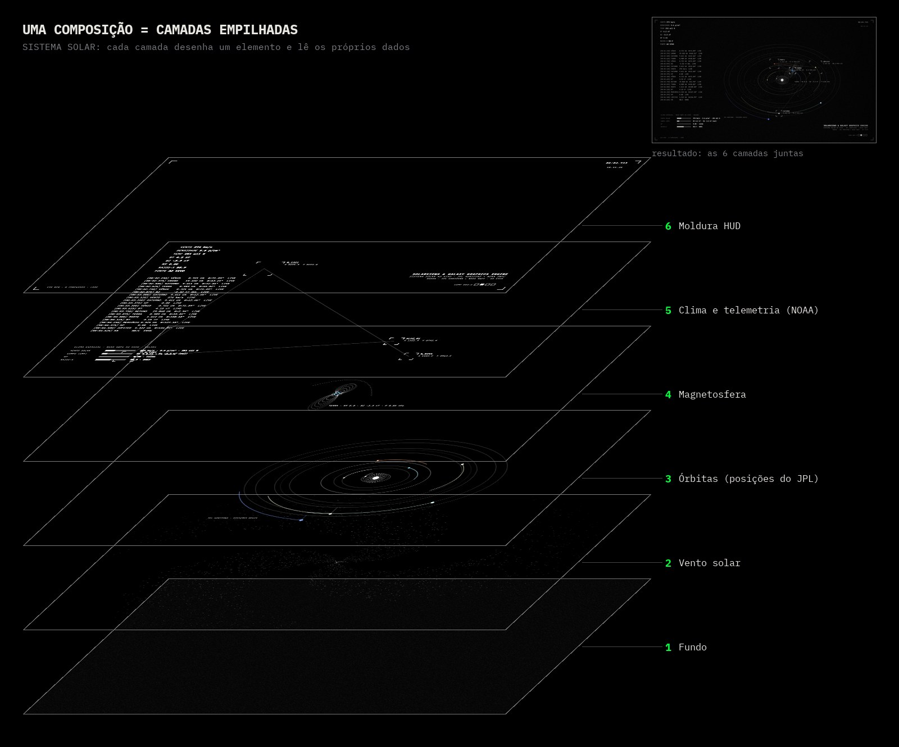</p>

Cada camada desenha um elemento e lê os próprios dados. As órbitas usam as posições do JPL, o vento solar acelera com a velocidade medida pelo NOAA, a magnetosfera se comprime com a pressão do vento e a telemetria mostra os valores do momento.

A câmera vê o plano do sistema solar de fora. As camadas de plano (céu, vento, campo) giram e deitam como uma folha. Os corpos (Sol, planetas, luas, galáxia) continuam redondos, e os instrumentos (HUD, telemetria, clima) ficam parados.

### Tempo musical, música e cenas

<p align="center">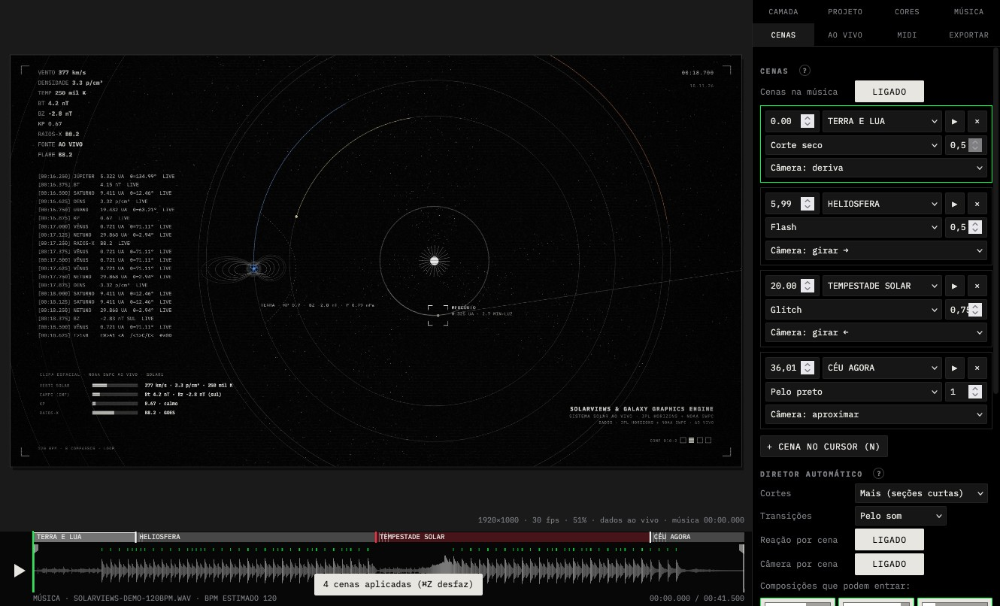</p>

O tempo das animações é musical. O BPM e os compassos definem um loop que fecha sem corte, e uma semente torna tudo reproduzível.

Com uma música carregada, a faixa é analisada de uma vez (30 leituras por segundo de graves, médios, agudos, energia e ataques), e a reação fica igual ao vivo, no scrub e na exportação.

As **cenas** marcam em que ponto da música entra cada composição, com transição (fusão, corte, pelo preto, flash, glitch, varredura, íris, zoom ou deslize) e movimento de câmera.

O **diretor automático** acha as seções da música e monta as cenas sozinho. A intensidade de cada trecho escolhe a composição, e o que o som faz na virada escolhe a transição.

### MOVER: mexer direto na prancheta

<p align="center">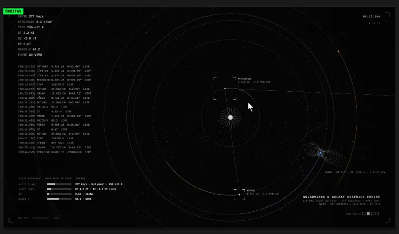</p>

Com o modo **MOVER** (tecla V):

- Passar o mouse mostra a caixa do elemento.
- Arrastar move o elemento, e o centro dele gruda no meio e nos terços da prancheta.
- A roda do mouse ou os cantos mudam o tamanho, e as setas movem 1 px por vez.

A telemetria, o log e o título do HUD também se movem. O contorno aparece só na vista, nunca na saída nem nos vídeos.

### Códigos ao vivo na telemetria

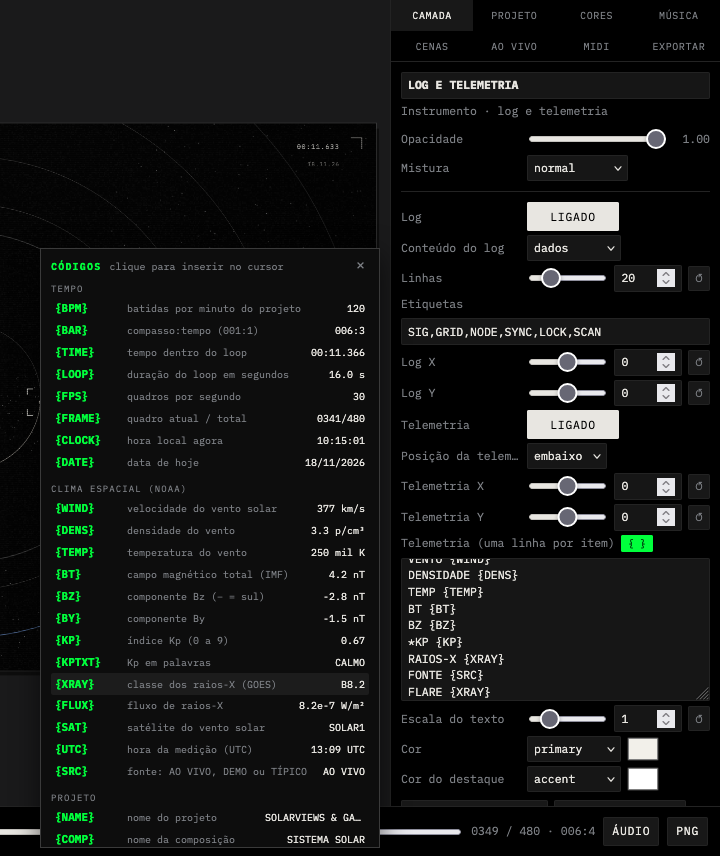

A telemetria e a camada Texto trocam códigos como `{WIND}`, `{KP}`, `{XRAY}`, `{BZ}`, `{SAT}` e `{BPM}` pelo valor do momento.

O ícone **{ }** ao lado do campo abre a lista de códigos com o valor atual de cada um. Clique para inserir no cursor.

Numa linha como `FLARE {XRAY}`, o texto antes do primeiro espaço vira o rótulo e o resto vira o valor.

<br clear="right">

### Ao vivo (VJ)

<p align="center">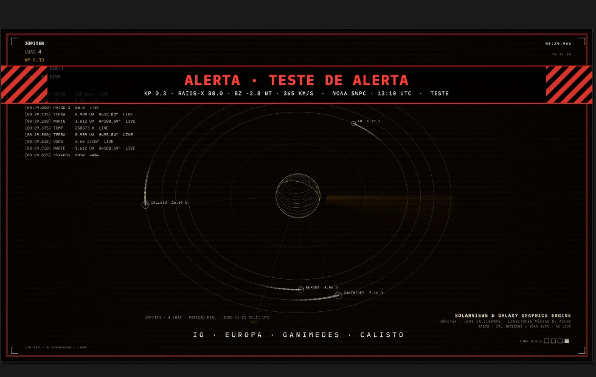</p>

Na aba **AO VIVO**:

- **Janela de saída:** abre só a prancheta, para o projetor ou a segunda tela.
- **Troca de composição:** pelas teclas 1 a 9 ou pelos pads MIDI, com transição na hora, no próximo tempo ou no próximo compasso.
- **Mestre e blackout.**
- **Alertas de clima espacial:** quando o Sol solta uma explosão ou o Kp sobe, a prancheta treme, pisca e mostra o aviso com os valores reais.
- **Medidor de desempenho:** com qualidade de prévia automática.

Na aba **MIDI**, o modo aprender liga knobs e pads a qualquer parâmetro.

### Formatos

<p align="center">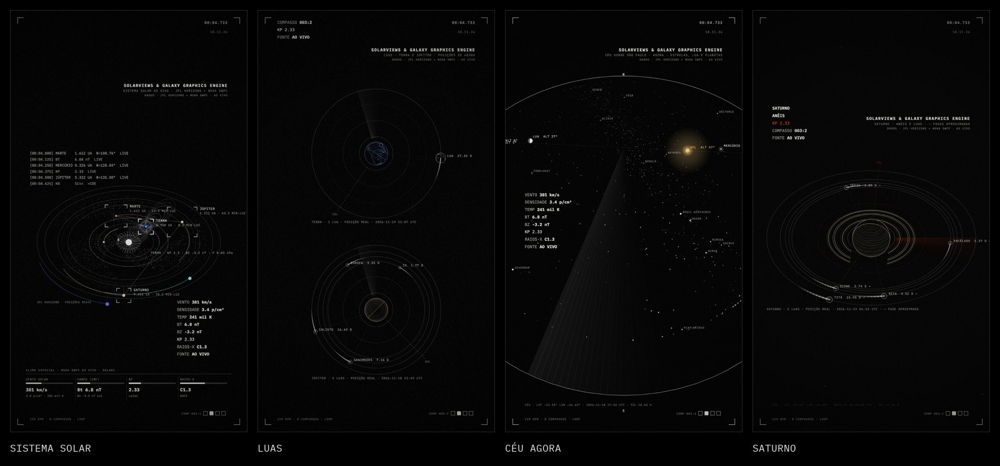</p>

Cada composição tem um layout próprio para o vertical (1080×1920), pronto para Reels e Stories. Os ajustes feitos no vertical ficam separados e não mexem no horizontal.

A exportação MP4 renderiza quadro a quadro, sem perder quadros, e codifica no próprio navegador. Os formatos são Reels e Stories 9:16, feed 4:5, quadrado, Full HD e 4K, com a duração em loops, em segundos ou a música inteira.

## Como foi desenvolvida

A ferramenta foi criada por Marcius Monteiro em novembro de 2026, em iterações curtas. Cada recurso nasceu de um uso real (projetar ao vivo, fazer vídeos para redes, ler os dados do espaço) e foi testado no navegador antes do seguinte.

O código foi escrito em parceria com o [Claude Code](https://claude.com/claude-code) (Anthropic). A concepção, a direção de arte, a curadoria das fontes de dados e os testes são do autor.

**Técnica**

- **Um arquivo só:** o `index.html` (~340 KB) tem o HTML, o CSS e o JavaScript, sem bibliotecas, sem build e sem dependências. Abre com duplo clique.
- **Render em Canvas 2D:** cada tipo de camada é registrado com `reg()` e desenha num quadro que fecha o loop (ciclos inteiros por loop). As transições entre composições usam um segundo buffer. A qualidade da prévia se ajusta sozinha, e as exportações saem sempre em 100%.
- **Dados:**
  - `fetch` dos JSON públicos do NOAA SWPC.
  - Servidor Node opcional (`server.js`) para o JPL Horizons.
  - Sem servidor, os planetas saem dos elementos keplerianos do JPL, conferidos contra o Horizons com diferença abaixo de meio grau.
- **Astronomia:** hora sideral, projeção estereográfica do céu com perspectiva, catálogo de 80 estrelas, fase e posição da Lua, luas galileanas e globos em projeção ortográfica com terminador real.
- **Música:**
  - Análise por FFT própria (2048 pontos, 30 leituras por segundo).
  - O diretor automático compara trechos de 0,5 s (matriz de semelhança por cosseno), acha as viradas pela curva de novidade de Foote e ajusta tudo à grade de compassos.
- **Exportação:**
  - **MP4:** WebCodecs (H.264), com o contêiner MP4 montado à mão no próprio arquivo.
  - **Sequência PNG:** ZIP escrito à mão.
  - **WebM:** MediaRecorder.
- **Ao vivo:** janela de saída com o laço de desenho rodando pela janela visível, Web MIDI com modo aprender e alertas por limiar.

**As imagens e os vídeos deste README saíram da própria ferramenta.**

- **Imagens:** renders quadro a quadro, com dados ao vivo de 18/11/2026.
- **Showreel:** exportado pelo exportador MP4 com as cenas sobre uma trilha gerada para o projeto.
- **Tutorial:** gravado da interface real.

## Estrutura do repositório

```
index.html        a ferramenta inteira (HTML, CSS e JavaScript)
font/             IBM Plex Mono e a licença dela (SIL OFL 1.1)
docs/MANUAL.md    manual completo: cada aba, camada, código e atalho
docs/img/         imagens deste README
docs/video/       showreel e tutorial (MP4)
docs/audio/       trilha de demonstração (AAC, 41 s, 120 BPM)
LICENSE           licença MIT
```

Para criar uma camada nova, acrescente um `reg(...)` e uma entrada em `FAMILIES` no `index.html`. O [manual](docs/MANUAL.md#estrutura-do-código) descreve a estrutura do código.

## Créditos e licença

- **Criação:** [Marcius Monteiro](https://marciusm.com).
- **Código:** licença [MIT](LICENSE). Use, modifique e distribua à vontade, mantendo o aviso de copyright. Ao usar ou adaptar, cite: *SOLARVIEWS & GALAXY GRAPHICS ENGINE, de Marcius Monteiro (marciusm.com)*.
- **Dados:** [NOAA Space Weather Prediction Center](https://www.swpc.noaa.gov/) e [NASA/JPL Horizons](https://ssd.jpl.nasa.gov/horizons/), dados públicos. Os elementos orbitais são de E. M. Standish (JPL). A ferramenta não é afiliada a essas instituições.
- **Fonte tipográfica:** [IBM Plex Mono](https://github.com/IBM/plex), © IBM Corp., licença SIL Open Font License 1.1 ([`font/OFL.txt`](font/OFL.txt)).
- **Trilha de demonstração:** gerada para este projeto, livre para testar a ferramenta.

---

## In English

**SOLARVIEWS & GALAXY GRAPHICS ENGINE** is a generative visuals engine for VJ performance and video, created by [Marcius Monteiro](https://marciusm.com). The Sun, planets, moons, sky and galaxy are layers combined into compositions. They move with **live space data**, follow the music's tempo and react to sound.

- **Live data:** while the tool is open, it reads data from public sources.
  - [NOAA SWPC](https://www.swpc.noaa.gov/): solar wind speed, density and temperature; the interplanetary magnetic field (Bt, Bz); the planetary Kp index; GOES X-ray flux. Read every 30 s, straight from the browser.
  - [NASA/JPL Horizons](https://ssd.jpl.nasa.gov/horizons/): planet positions, through the optional local server (`server.js`). Without the server, positions come from JPL's Keplerian elements.
  - The real-time clock: sky, Moon and sidereal time.
- **Run it:** open `index.html` in Chrome, Edge or Firefox (Safari is untested). There is nothing to install, and it works on any static host (only `index.html` and `font/` are needed).
- **Features:**
  - 17 example compositions and 21 layer types.
  - Music analysis, with scenes and an automatic director.
  - Output window, 1–9 / MIDI switching and space-weather alerts.
  - Direct manipulation mode (MOVE).
  - Export to MP4 (Reels, feed, square, Full HD, 4K), PNG, PNG sequence and WebM.
- **Built as a single HTML file** with Canvas 2D and no dependencies, written in collaboration with Claude Code.
- **Language:** the interface is available in English and Portuguese. Use the PT/EN switch at the top or on the opening screen, or open `index.html?lang=en`. On the first visit it follows the browser language, and the choice is remembered. Text drawn on the artboard (HUD, telemetry, alerts) is translated too, so exported videos come out in the chosen language. The [manual](docs/MANUAL.md) is in Portuguese.
- **License:** code under [MIT](LICENSE). Please keep the copyright notice and credit *"SOLARVIEWS & GALAXY GRAPHICS ENGINE by Marcius Monteiro (marciusm.com)"*. The IBM Plex Mono font is under the SIL OFL 1.1.
